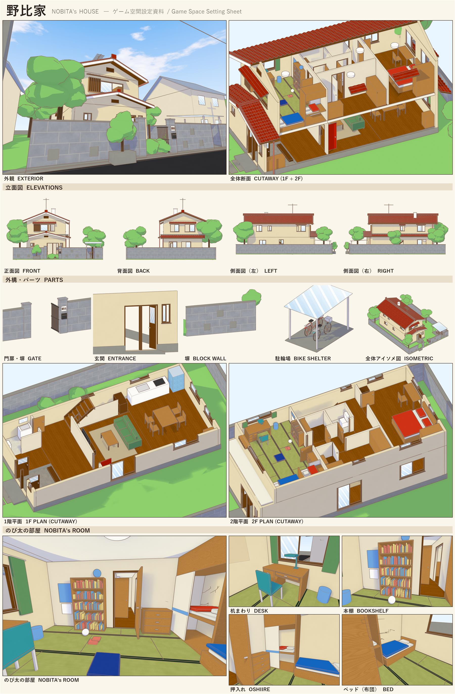

# 野比家 Nobita's House — 第一人稱探索（three.js）

以漫畫風格重現《哆啦A夢》野比家的 3D 空間。可以用第一人稱走進屋內、上下樓梯，並開關門、窗、抽屜和壁櫥紙拉門。看著物件時會顯示它的名稱和說明。



## 操作

| 按鍵 | 功能 |
|---|---|
| `W A S D` / 方向鍵 | 移動 |
| `Shift` | 跑步 |
| 滑鼠 | 轉動視角（點擊畫面後鎖定滑鼠） |
| `E` / 左鍵 | 開關準星對準的門、窗、抽屜、紙拉門、大門 |
| `L` | 顯示／隱藏附近物件的名稱標籤 |
| `Esc` | 暫停 |

左上角會顯示目前所在的房間。

## 本機執行

這是不需要編譯的靜態網站（three.js 透過 importmap 從 CDN 載入），用任何靜態伺服器開啟即可：

```bash
npx serve .
```

或

```bash
python -m http.server 8765
```

然後開啟 `http://localhost:8765`（直接雙擊 `index.html` 會因為瀏覽器的 CORS 限制而無法載入模型）。

## 部署到 Vercel

1. 在 Vercel 匯入這個 GitHub repo。
2. Framework Preset 選 **Other**，Build Command 留空，Output Directory 用預設的根目錄。
3. 部署完成。`vercel.json` 已設定模型檔的快取標頭。

也可以用 CLI：`npx vercel --prod`

## 專案結構

```
index.html            入口與 HUD
src/main.js           遊戲邏輯：載入、漫畫渲染、第一人稱移動與碰撞、互動、標籤
src/style.css         介面樣式
models/nobita_house.glb  漫畫風模型（Draco 壓縮，約 2.2 MB，含 45 段開關動畫）
blender/scripts/      產生模型的 Blender Python 腳本
docs/                 設定稿
```

## 模型裡的資料（glTF extras → three.js `userData`）

| 屬性 | 說明 |
|---|---|
| `openable` | `hinge`（轉開的門）、`slide`（推拉窗／紙拉門）、`drawer`（抽屜） |
| `anim_open_action` | 對應的動畫名稱，例如 `Door_2F_Nobita_Open`。第 0 格是關，最後一格是開：正向播放＝打開，反向播放＝關上 |
| `label` / `desc` | 物件名稱與說明（繁體中文） |
| `room` | 地板所屬的房間名稱（用來顯示目前位置） |

名稱含 `-colonly` 的物件（樓梯斜坡）只用來碰撞，不會顯示。

## 漫畫風渲染的做法

- 模型的貼圖已預先烘焙成「平塗色＋淡淡紋理」。
- 載入時把材質換成 `MeshToonMaterial`（三階色階）。
- 用 `OutlineEffect` 描咖啡色輪廓線。
- 天空是程式繪製的藍天積雲。

## 重新產生模型（Blender 5.2）

`blender/scripts/` 裡的腳本可以從零重建整棟房子。依序執行 `textures.py`、`build_shell.py`、`build_interior.py`、`build_site.py`、`finish.py`、`animate.py`，最後用 `toon_export.py` 的 `export_toon_glb()` 匯出網頁用模型。

---

非商業的同人練習作品。《哆啦A夢》相關角色與設定之著作權屬於藤子製作公司及相關權利人。
